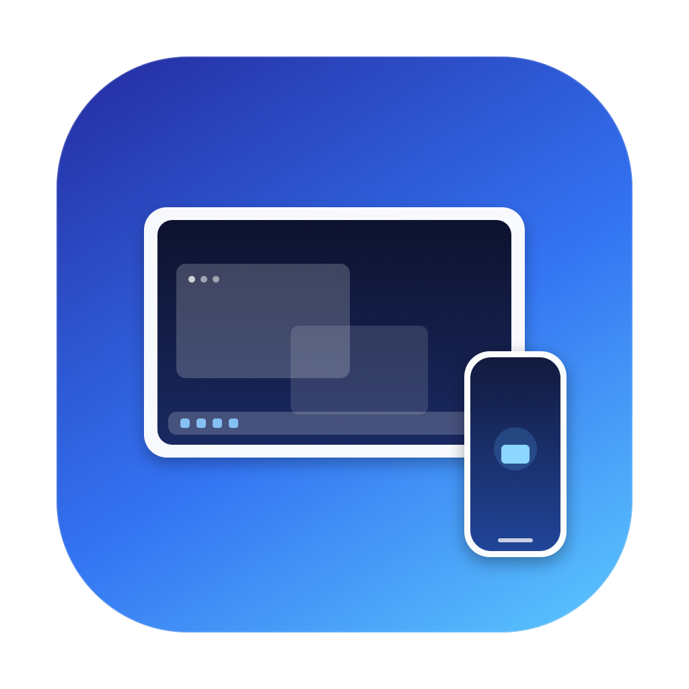

# DeX for Mac

Run **Samsung DeX** on a Mac over **USB-C** or **Wi-Fi**. DeX for Mac is a small
native SwiftUI app that drives [scrcpy](https://github.com/Genymobile/scrcpy)
and Android's `adb` for you: pick your Galaxy phone, press **Start DeX**, and the
DeX desktop opens in its own window.



> Not affiliated with Samsung Electronics. DeX and Galaxy are trademarks of
> Samsung Electronics. scrcpy is open source under Apache 2.0.

---

## Requirements

| | |
|---|---|
| Mac | macOS 14 Sonoma or newer. The provided DMG is for Apple silicon; Intel Macs can build from source (the tools script downloads the x86_64 build) |
| Phone | Samsung Galaxy on **One UI 8 / Android 16** or newer |
| Cable | A data-capable USB-C cable (not charge-only) for the wired route |
| Phone setting | **Developer options → USB debugging** turned on |

Real Samsung DeX on an external display is what makes this work. scrcpy creates
a virtual display on the phone (`--new-display`), and One UI 8 turns that
display into a DeX desktop. On older One UI versions the same command gives you
a plain second Android screen instead of DeX — the app still works as a
secondary-display tool, but it is not DeX.

The app bundles `adb`, `scrcpy` and `scrcpy-server`, so it runs out of the box
with no Homebrew, Android SDK or internet connection.

---

## Install

1. Download or build **`DeX-for-Mac.dmg`**.
2. Open the DMG and drag **DeX for Mac** into **Applications**.
3. Launch it. The first-run welcome explains the phone-side setup.

The app is **ad-hoc signed**, not notarized. Because it was built locally it
normally opens without a warning. If you copied it from another Mac and macOS
blocks it, run:

```bash
xattr -dr com.apple.quarantine "/Applications/DeX for Mac.app"
```

---

## Use it

### USB-C

1. On the phone, enable **Developer options → USB debugging**.
2. Plug the phone into the Mac with a data cable.
3. Unlock the phone and tap **Allow** on “Allow USB debugging?”. Tick
   **Always allow from this computer**.
4. The phone appears in the sidebar. Select it and press **Start DeX**.

### Wi-Fi, with a pairing code (no cable)

Android 11 and newer support wireless debugging without ever plugging in.

1. Phone: **Settings → Developer options → Wireless debugging → On**.
2. Tap **Pair device with pairing code**. Keep that dialog open.
3. In DeX for Mac choose **Connect over Wi-Fi…** (or **Go cable-free…** from
   the empty state).
4. Nearby phones are discovered automatically. Pick yours, enter the 6-digit
   code, and press **Pair & Connect**.

The app also fills in the connection port automatically when mDNS discovery
works; otherwise type the IP and ports shown on the phone.

### Wi-Fi, the one-click way (needs a cable once)

1. Connect by USB and authorize the computer.
2. Select the phone → **Go cable-free…**.
3. The app finds the phone's Wi-Fi address, switches adb to TCP/IP and connects.
4. Unplug the cable. The saved phone stays in the sidebar and reconnects on
   launch if **Reconnect saved Wi-Fi devices on launch** is enabled.

Wireless debugging survives until the phone reboots or you turn it off. Use
**Reconnect Wi-Fi** in the DeX menu or the sidebar afterwards.

---

## Features

- **USB and wireless** connections, with mDNS discovery and pairing-code flow.
- **Real DeX** through scrcpy's `--new-display` virtual display.
- **Display presets**: Full HD, QHD, laptop, 4K, match-the-phone, or a custom
  resolution and DPI.
- **Launch options**: fullscreen, always on top, keep the phone awake, turn the
  phone screen off, physical keyboard (UHID), audio forwarding.
- **Wireless tuning**: H.264 / H.265 / AV1, bitrate, frame-rate cap and video
  buffer.
- **Phone screen mirroring** as well as DeX, from the same device page.
- **Menu bar extra**: start, stop, reconnect and mirror without the main window.
- **Diagnostics**: one click copies adb/scrcpy versions, device state and the
  current session log for troubleshooting.
- **Tool management**: bundled tools, optional SHA-256-verified download of the
  latest scrcpy, and custom adb/scrcpy paths in Settings → Tools.
- **Isolated adb server** on port 5038 for people who also use Android Studio.

---

## Build from source

You need the Swift toolchain (Xcode Command Line Tools are enough) and macOS 14+.

```bash
git clone <this-repo> dex
cd dex

# Debug build and run
swift build
swift run DeXMac

# Engine tests (72 checks, no XCTest required)
swift run dex-self-test
```

### Package the app

```bash
./scripts/build-app.sh          # dist/DeX for Mac.app
./scripts/build-app.sh --dmg    # also dist/DeX-for-Mac.dmg
```

`build-app.sh` runs a release build, generates the `.icns` from
`Resources/AppIcon-1024.png`, copies the bundle metadata and tools, and
ad-hoc signs the result.

Verify a built bundle, including its embedded toolchain:

```bash
"dist/DeX for Mac.app/Contents/MacOS/DeXMac" --self-check
```

Expected output ends with:

```
Origin: Bundled with DeX for Mac
adb version:    1.0.41
scrcpy version: 5.0.1
PASS: bundled toolchain is ready.
```

### Refresh the bundled tools

`vendor/tools/` is populated from the pinned scrcpy release. To re-download it
(with SHA-256 verification against the release's `SHA256SUMS.txt`):

```bash
./scripts/fetch-tools.sh --force
```

Set `SCRCPY_VERSION=…` to pin a different release. The app can also install the
latest release itself from **Settings → Tools**.

---

## How it works

```
DeX for Mac (SwiftUI)
        │
        ├── adb devices / getprop / mdns services     ← device discovery
        ├── adb pair / adb connect / adb tcpip 5555    ← wireless setup
        └── scrcpy -s <serial> --new-display=WxH/DPI   ← the DeX window
                    └── scrcpy-server (pushed by scrcpy)
```

- The phone must expose a virtual display. scrcpy's `--new-display` does that
  without touching the phone's own screen.
- `ADB` is pointed at the bundled `adb`, and `ANDROID_ADB_SERVER_PORT` is set
  only when the isolated-server option is on.
- Wireless streaming adds codec, bitrate, frame-rate and buffer flags tuned for
  Wi-Fi; audio forwarding is off by default on Wi-Fi.
- Tool discovery order: custom paths → Application Support (app-installed
  updates) → app bundle → Homebrew → Android SDK/PATH.

---

## Troubleshooting

**The phone never appears**

- Unlock the phone. The “Allow USB debugging?” prompt only appears on an
  unlocked screen.
- Use a data cable and a direct port, not a charge-only cable or a hub.
- On Samsung, pull down the USB notification and choose **Transferring files /
  Android Auto** — “Charging only” can hide adb.
- Revoke stale authorizations: **Developer options → Revoke USB debugging
  authorizations**, then replug and accept again.
- Try **Settings → General → Use an isolated adb server** if another adb server
  (Android Studio, scrcpy) is holding port 5037.

**“unauthorized” keeps showing**

Tap **Allow** on the phone, or delete `~/.android/adbkey` and `adbkey.pub`, then
replug and authorize again.

**It connects, but there is no DeX desktop**

- Check **Settings → About phone → Software information → One UI version**. DeX
  through a virtual display requires **One UI 8 / Android 16**.
- Make sure you pressed **Start DeX**, not **Mirror phone screen**.
- Some carrier or enterprise firmware disables DeX. Confirm DeX works when the
  phone is plugged into a monitor.

**The DeX window is black, laggy or disconnects on Wi-Fi**

- Move the Mac and phone closer to the same access point; avoid guest networks,
  client isolation and VPNs.
- Lower the resolution (Full HD), drop the frame cap to 30 fps, or raise the
  video buffer to 100–150 ms in the wireless section.
- Try H.264 instead of H.265 if the Mac cannot decode HEVC smoothly.

**Pairing fails with “wrong password” or times out**

- The pairing port is random and changes every time the dialog opens. Reopen
  **Pair device with pairing code** and use the new port and code.
- Both devices must be on the same subnet. A VPN on either device will break it.
- The pairing dialog must stay open until pairing finishes.

**“adb and scrcpy were not found”**

Open **Settings → Tools** and either download the latest scrcpy or point the app
at existing binaries. The copy inside the app bundle is used automatically when
present.

**macOS says the app is damaged or cannot be opened**

It is ad-hoc signed rather than notarized. Remove the quarantine flag:

```bash
xattr -dr com.apple.quarantine "/Applications/DeX for Mac.app"
```

---

## Limitations

- Real DeX requires One UI 8 / Android 16 or newer on the phone.
- One DeX session at a time per phone; stop the current session before changing
  resolution or codec.
- The app drives scrcpy rather than Samsung's proprietary DeX protocol, so
  Samsung-specific extras (DeX pad shortcuts, some multi-window gestures) may
  differ from a DeX dock.
- Wireless quality depends on the network; USB is always smoother.
- The app is not notarized and is not distributed through the Mac App Store.
- No automatic updates.

---

## Project layout

```
Sources/DeXCore/          Engine: adb client, parsers, process runner,
                          toolchain discovery/install, scrcpy arguments
Sources/DeXMac/App/       App state, preferences, scrcpy session, self-check
Sources/DeXMac/UI/        SwiftUI views: sidebar, device page, settings,
                          pairing sheet, menu bar, welcome
Sources/DeXCoreSelfTest/  Dependency-free test executable
Resources/Info.plist      Bundle metadata and local-network permissions
Resources/AppIcon-1024.png
scripts/make-icon.sh      Draws the icon with AppKit
scripts/fetch-tools.sh    Downloads + verifies the pinned scrcpy release
scripts/build-app.sh      Builds and signs the .app (and optional DMG)
vendor/tools/             adb, scrcpy, scrcpy-server bundled into the app
```

## License and credits

The app's own source is MIT licensed; see `LICENSE`. Bundled third-party
components keep their own licenses:

- **scrcpy** — Apache License 2.0, © Genymobile. See
  `vendor/tools/LICENSE` and <https://github.com/Genymobile/scrcpy>.
- **Android platform-tools / adb** — Android Open Source Project, Apache
  License 2.0.
